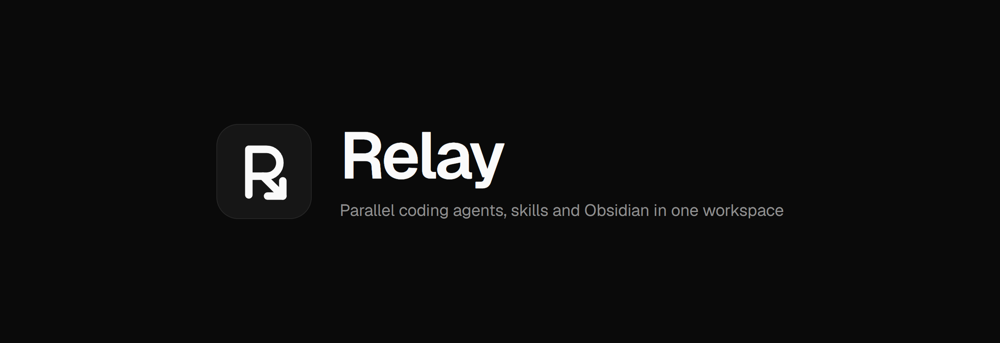

# Relay



A desktop workbench for running CLI coding agents in parallel, each in its own git worktree.

Relay is a personal version of [Orca](https://github.com/stablyai/orca) with additions for viewing and managing skills per project and for working with Obsidian vaults. It will be updated as new needs come up.

## Features

### General

- **Workspaces as git worktrees.** Each new workspace gets a generated two-word name (for example `amber-beacon` or `swift-uplink`), its own branch (`<prefix>/<name>`) and a folder under `~/relay/workspaces/<repo>/<name>`. Folders that are not git repositories open as a single workspace.
- **Setup scripts** defined in the project settings or in `scripts.setup` in `relay.yaml`, run in a *Setup* tab after the workspace is created.
- **Agent launcher.** Detects 24 agent CLIs on `PATH` and starts them with the given prompt, using each CLI's own mechanism (argument, `--prompt`, `--prompt-interactive`, `-i`, or typed in after start). Per-agent command overrides.
- **Live agent status** read from terminal titles: working, idle and needs-input indicators in the sidebar, tabs and status bar, plus system notifications and unread markers when a turn ends.
- **Terminals.** xterm on ConPTY, split panes, search, scrollback restored across restarts, file drop pastes paths, and Shift+Enter for multi-line prompts.
- **Code.** File explorer, Monaco editor with autosave, quick open (Ctrl+P) and workspace search (`git grep`).
- **Source control.** Stage, unstage and discard, commit, push and pull, side-by-side or inline diffs, and review comments on diff lines that can be sent straight to an agent.
- **Browser tab** with a design mode that picks an element and sends its selector and HTML to an agent.
- **Usage meter** in the sidebar: share of the plan's 5-hour session and weekly limits used, with time until reset, plus tokens for the current window and for the day, read from the CLI's local logs.
- **Updates.** On the first launch of each day Relay checks this repository's latest GitHub release. A newer Windows installer downloads in the background, and Relay then offers to restart into it or skip. The refresh button in the sidebar footer runs the same check on demand.
- Workspace board statuses (Todo, In progress, In review, Done), grouping, pinning, and light, dark or system theme.

### Skills and Obsidian

- **Skills per project** (skills tab in the right sidebar). Lists personal skills, skills synced from the account and the project's own skills.
  - **Checkbox:** turns a skill on or off for that project only. Relay writes `skillOverrides` to `settings.local.json` in the main checkout and in every worktree, because worktrees do not share that file. New worktrees inherit the project's choices.
  - **Edit:** opens the skill's files in the editor. Editing a personal skill changes it in every project.
  - **Adapt:** copies a skill into the project as `<name>-local` and turns the original off there. A copy with the same name would not work, because personal skills take precedence over project skills. Deleting the copy turns the original back on.
- **Notes tab** (Ctrl+Shift+O, or *+ > Notes*) for an Obsidian vault. Relay reads and writes the same files Obsidian does, so both apps can stay open on the same vault. The vault list comes from Obsidian's `obsidian.json`; any folder can also be opened as a vault, or a default set under *Settings > Notes*.
  - Reading, editing and side-by-side views. Supports `[[wikilinks]]` (completed after `[[`), `![[embeds]]` (images, notes and `#heading` sections), `#tags`, properties, callouts, `==highlights==` and tasks that can be ticked in the reading view.
  - Backlinks with context, outgoing and unresolved links, outline, tag browser, full-text search, graph view and today's daily note (from `.obsidian/daily-notes.json`).
  - Renaming a note updates the links that point to it. Clicking an unresolved link creates the note.
  - *Open in Obsidian* (`obsidian://`) and *Send to agent*, which passes the note's path, or the selected text, to the workspace's agent.

## Development

```sh
npm install
npm run dev        # electron-vite with HMR
npm test           # node:test unit tests
npm run typecheck
npm run build      # output in out/
npm run dist       # Windows installer (dist/Relay-Setup-<version>.exe)
```

Requires git on `PATH`. State lives in Electron's `userData` folder (`%APPDATA%\Relay`: `state.json`, `sessions.json`). The app icon is drawn in `resources/icon.svg`; `icon.png` and `icon.ico` are rendered from it.

## Layout

| Path | Contents |
| --- | --- |
| `src/main` | Electron main process: state store, git and worktree operations, PTY manager, file watching, IPC |
| `src/preload` | `window.relay` bridge |
| `src/shared` | Types, agent catalog and launch plans, title-based agent status, workspace names |
| `src/renderer` | React UI (zustand store, xterm registry, Monaco, components) |
| `tests` | Unit tests |

## License

MIT. Includes code from Orca, copyright (c) 2026 Lovecast Inc. See [LICENSE](LICENSE).
